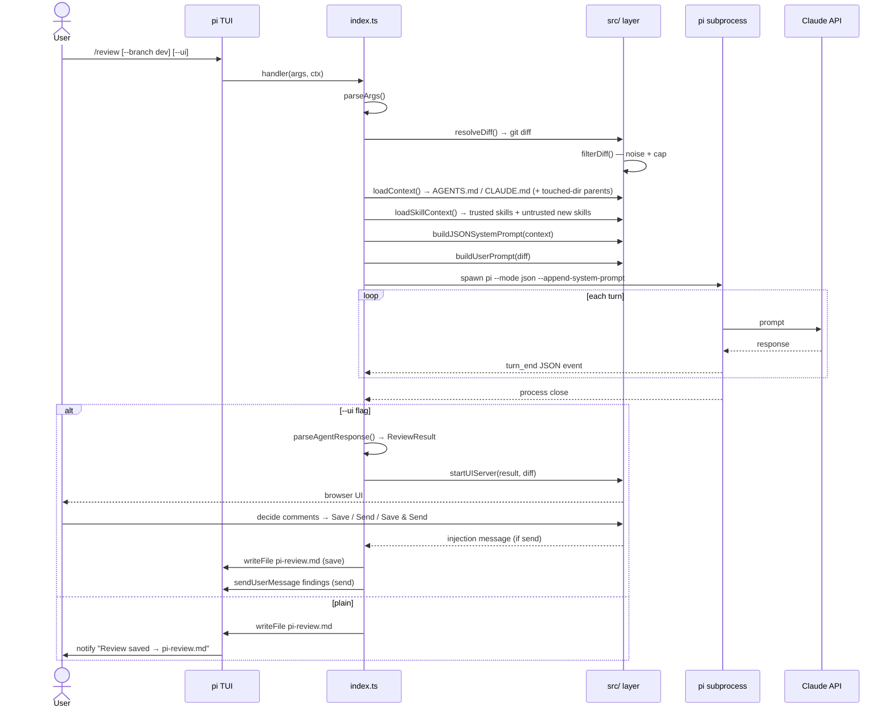
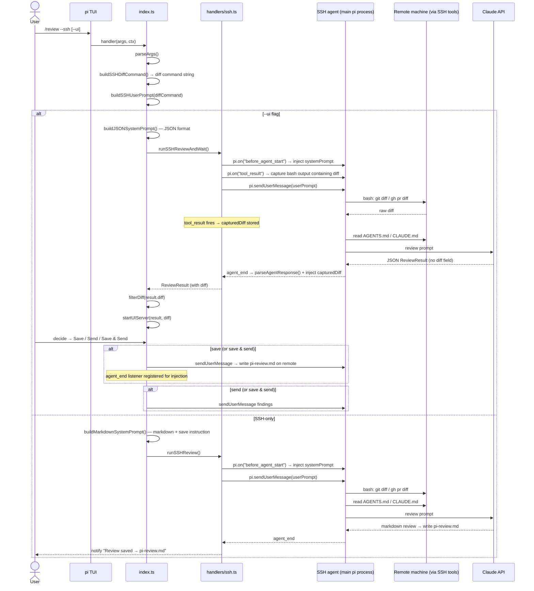
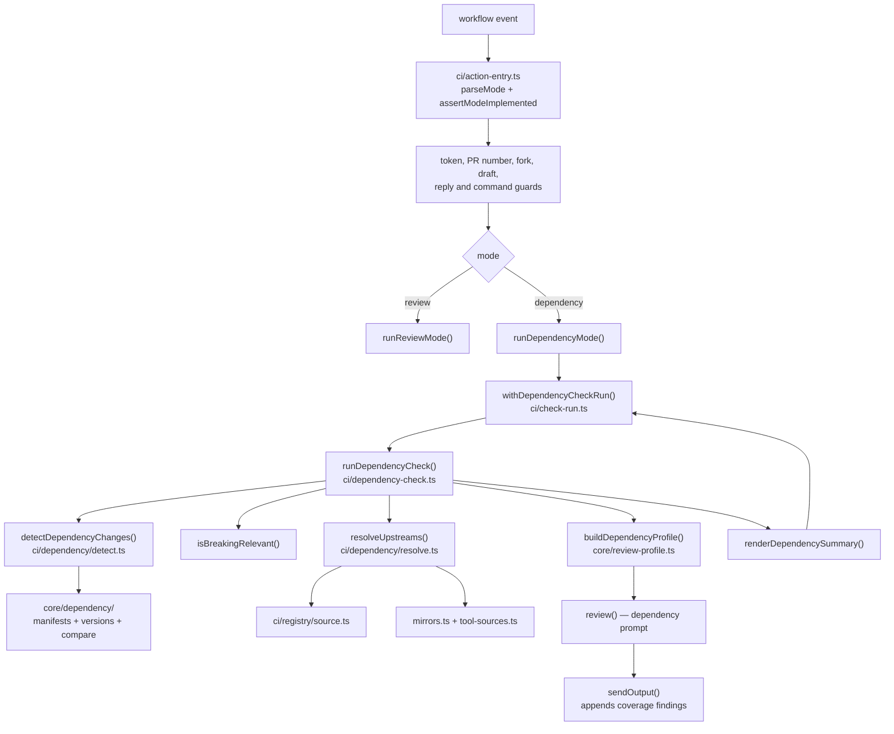

# Architecture

## Layers

```mermaid
flowchart TD
    subgraph pi["pi-coding-agent (ExtensionAPI)"]
        cmd["/review command"]
    end

    subgraph ext["Extension Layer (extensions/pi-reviewer/)"]
        args["args.ts\nparseArgs()"]
        footer["footer.ts\nsetReviewFooter()"]
        index["index.ts\ncommand handler"]
        events["events.ts\ncreateEventAccumulator()"]
        subgraph handlers["handlers/"]
            runlocal["local.ts\nrunLocalReview()\nhandleLocalReview()"]
            runssh["ssh.ts\nrunSSHReview()\nrunSSHReviewAndWait()\nhandleSSHReview()"]
            uihandler["ui.ts\nhandleUIReview()"]
            dryrun["dry-run.ts\nhandleDryRun()"]
            ctxhelper["context.ts\nbuildContextGroups()"]
        end
    end

    subgraph src["Source Layer (src/)"]
        resolver["diff-resolver.ts\nresolveDiff()"]
        filter["diff-filter.ts\nfilterDiff()"]
        context["context.ts\nloadContext()"]
        prompt["prompt-builder.ts\nbuildJSONSystemPrompt()\nbuildMarkdownSystemPrompt()\nbuildUserPrompt()\nbuildSSHUserPrompt()"]
        output["output.ts\nparseAgentResponse()"]
        uiserver["ui/\nstartUIServer()"]
    end

    subgraph subprocess["Subprocess (pi --mode json)"]
        agent["pi-agent-core\nAgent"]
        ssh["ssh.ts extension\n(if active)"]
        claude["Claude API"]
    end

    tui["@earendil-works/pi-tui"]
    git["git / gh CLI"]
    fs["AGENTS.md / CLAUDE.md"]
    browser["Browser UI"]

    cmd --> index
    index --> args
    index --> footer --> tui
    index --> runlocal --> events
    index --> runssh
    index --> uihandler --> uiserver --> browser
    index --> dryrun
    index --> ctxhelper
    index --> resolver --> filter --> git
    index --> context --> fs
    index --> prompt
    index --> output
    runlocal -->|"spawn pi --mode json"| subprocess
    runssh -->|"pi.on / pi.sendUserMessage"| subprocess
    agent --> ssh
    agent --> claude
    subprocess -->|"JSON events"| events
```

## Runtime flow

## Generated artifacts

The GitHub Action and CLI run the TypeScript sources directly through `tsx`;
there is no checked-in TypeScript build output. The browser UI remains a
single-file build at `dist-ui/index.html`, which is consumed by the local UI
server. Run `mise exec -- pnpm build` after source changes; this type-checks the
sources and regenerates the UI artifact.

### Local mode (`/review`)

### SSH mode (`/review --ssh`)

## Key design decisions

### Why the agent fetches its own diff in SSH mode

In SSH mode, the agent's bash/read/write/edit tools are transparently redirected over SSH by the `ssh.ts` extension. When we ask the agent to run `git diff ...`, it runs on the remote automatically. This means we don't need to implement SSH ourselves — we just tell the agent which command to run.

Previously the diff was fetched locally via `pi.exec`, but `pi.exec` is a plain local `spawn()` — it is **not** SSH-redirected. Only the agent's tools are. So having the agent fetch its own diff is both simpler and correct.

### Why the diff is captured from `tool_result` in SSH+UI mode

In SSH+UI mode, the UI needs the full diff for rendering. Asking the agent to echo the diff back inside its JSON response would:
1. Print the entire diff to the terminal as part of the agent's response text
2. Increase token count and slow down streaming

Instead, `handlers/ssh.ts` listens to the `tool_result` event and captures any bash output that contains `diff --git` — the standard git diff format. This gives us the full diff silently, without it appearing in the agent's response.

### Why `handleUIReview` returns the injection message instead of sending it

`handleUIReview` is called while the command handler is still suspended at `await handleUIReview(...)`. Calling `pi.sendUserMessage` from inside a suspended command causes an "Agent is already processing" error when:
- SSH+UI save-and-send: `saveRemote` already started the agent; the injection can't start a second concurrent turn.

The fix: `handleUIReview` returns the injection message. The caller sends it at the right time:
- **Local / SSH send-only**: agent is idle → `pi.sendUserMessage(injectionMsg)` called before the command returns.
- **SSH save-and-send**: `saveRemote` started the agent → a one-time `agent_end` listener sends the injection after the save turn completes (by which point the command has already returned).

### System prompt structure

`prompt-builder.ts` has a private `buildSharedBase(minSeverity)` that holds the role, severity tiers, rules, and severity filter — the ~90% shared between both public functions:

- **`buildJSONSystemPrompt(context, minSeverity)`** — adds the conventions-don't-repeat rule, JSON schema, and injects conventions/review-rules from context. Used by local mode and SSH+UI.
- **`buildMarkdownSystemPrompt(minSeverity)`** — adds the markdown format instructions and the save-to-pi-review.md instruction. Used by SSH-only.

User prompts:
- **`buildUserPrompt(diff, skippedFiles)`** — diff only; conventions already in system prompt (local mode).
- **`buildSSHUserPrompt(diffCommand)`** — instructs the agent to run the given diff command, then read `AGENTS.md`/`CLAUDE.md`, then review. Used by both SSH modes since the agent fetches everything at runtime.

### Finding output contract

Review findings are normalized once at the model boundary into canonical prose
plus structured location/severity fields. Severity emoji, GitHub metadata,
`
` wrappers, fences, and the AI Fixit footer are presentation only.
The summary renderer and Fixit renderer consume the canonical finding
independently; current output is never stripped and reparsed. A small legacy
decoder remains only for reading already-posted GitHub findings during
deduplication and lifecycle reconciliation.

### SSH-only vs SSH+UI divergence

Both modes share identical setup (`buildSSHDiffCommand` + `buildSSHUserPrompt`). They diverge only on:
- **System prompt format**: `buildMarkdownSystemPrompt` (markdown + save instruction) vs `buildJSONSystemPrompt` (JSON schema)
- **Agent execution**: `runSSHReview` (fire-and-forget) vs `runSSHReviewAndWait` (awaits JSON result + captures diff from `tool_result`)
- **Post-review**: SSH-only agent saves the file itself; SSH+UI returns the result to the local process for UI rendering

## CI modes

The action performs one of two checks, chosen by the `mode` input
(`src/ci/mode.ts`, parsed and validated in `action-entry.ts` before anything
else runs). Which pull requests reach a mode is the calling workflow's
decision; the action never selects them. The review mode keeps its
`renovate[bot]` skip, and the dependency mode does not skip those pull
requests, because a Renovate bump is its use case. Both modes share the same
preparation — the analyzed-head worktree, the trusted MCP and LSP
configuration, the model and credential options — and nothing else: each
mode's batch state is selected by its own `mode` field, so a dependency-mode
marker, review, or finding can never supply a review-mode range or summary
(`selectAuthenticatedBatchMarkers`, `collectFindingHistory`,
`isFirstBodiedReview` in `src/ci/batch.ts`).

### Dependency mode modules

- **Pure detection** (`src/core/dependency/`): `types.ts` (registries,
  dialects, change kinds), `versions.ts` (per-dialect grammars and comparison),
  `manifests.ts` with the bounded readers (`toml.ts`, `xml.ts`, `yaml.ts`,
  `nuget.ts`, `gemfile.ts`, `gradle.ts`) and the aqua registry classifier
  (`aqua.ts`), `compare.ts`, `threshold.ts`, `upgrade-id.ts` (the
  harness-assigned id a disposition cites), `prompt-section.ts` (the
  `<dependency_changes>` section), and `noise.ts`.
- **Git side** (`src/ci/dependency/`): `detect.ts` reads the changed paths and
  both ends of each changed manifest from git; `resolve.ts` turns each upgrade
  into candidate upstream locations, with `mirrors.ts` (curated non-GitHub
  mirrors) and `tool-sources.ts` (tool-backend registries); `anchors.ts` maps
  an upgrade to the diff line its constraint changed on; `accounting.ts`
  derives one disposition per upgrade from the model's report.
- **Flow**: `ci/dependency-check.ts` runs detect → filter → resolve → review →
  summary, and `ci/check-run.ts` owns the check-run lifecycle: a fresh
  `in_progress` run per invocation, a conclusion after it, annotations chunked
  at 50, and the unannotated findings named in the summary. A missing
  `checks: write` is a warning, never a failed review.
- **Research surfaces**: the dependency prompt uses the same readers as the
  review mode — `github_read` (default on) and the bounded URL reader
  (`src/ci/web-fetch/`, off unless `url-reader` is set). The reader is the only
  tool that reaches an arbitrary host, so its admissibility rules, address
  checks, and byte caps are part of the feature rather than an implementation
  detail.
- **Publication**: `ci/review.ts` turns the model's dispositions into coverage
  findings (a `WARN` per upgrade that could not be verified, anchored on the
  upgrade's line where the diff has one), withdraws model findings that sit on
  an unverified upgrade's line, and withholds a body that carries a
  credential-shaped value (`src/core/credential-scan.ts`). Coverage findings
  are appended after normalization in `core/output.ts`, so `min-severity`
  cannot hide them.
